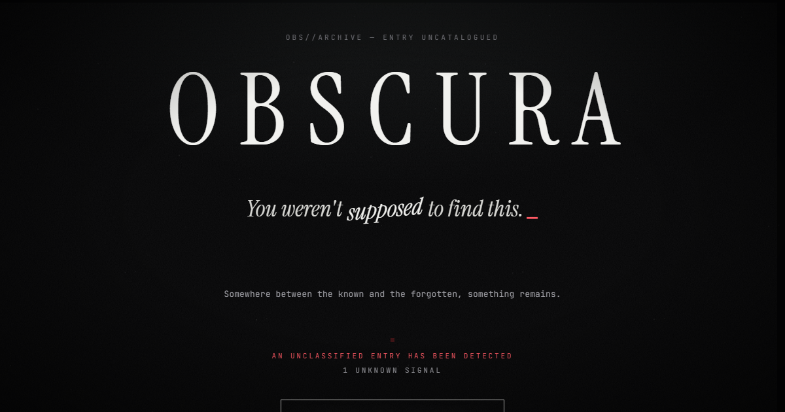
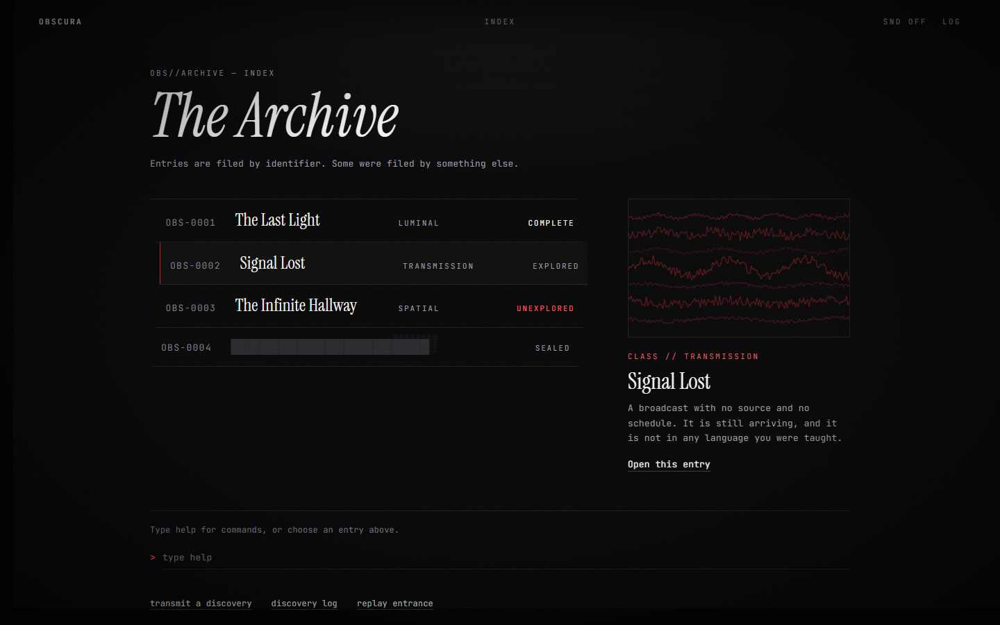
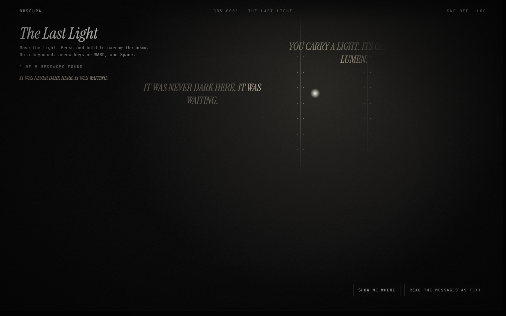
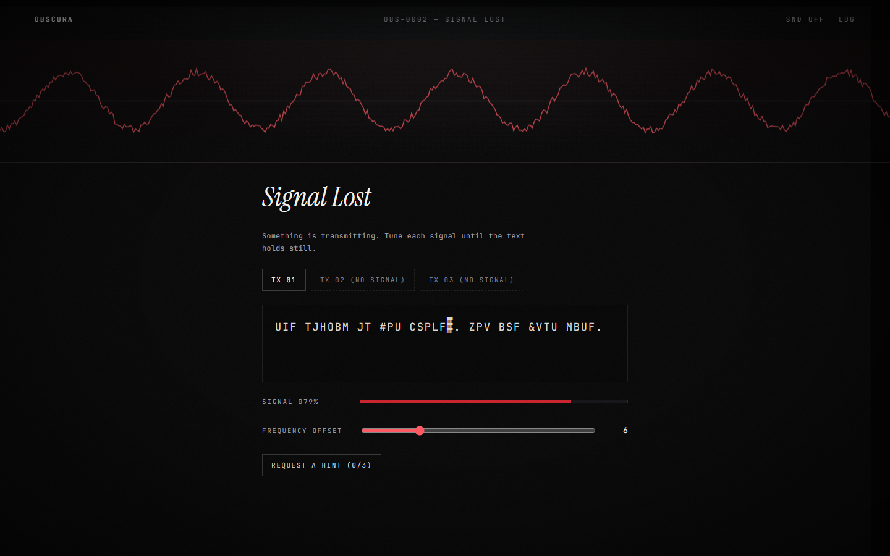
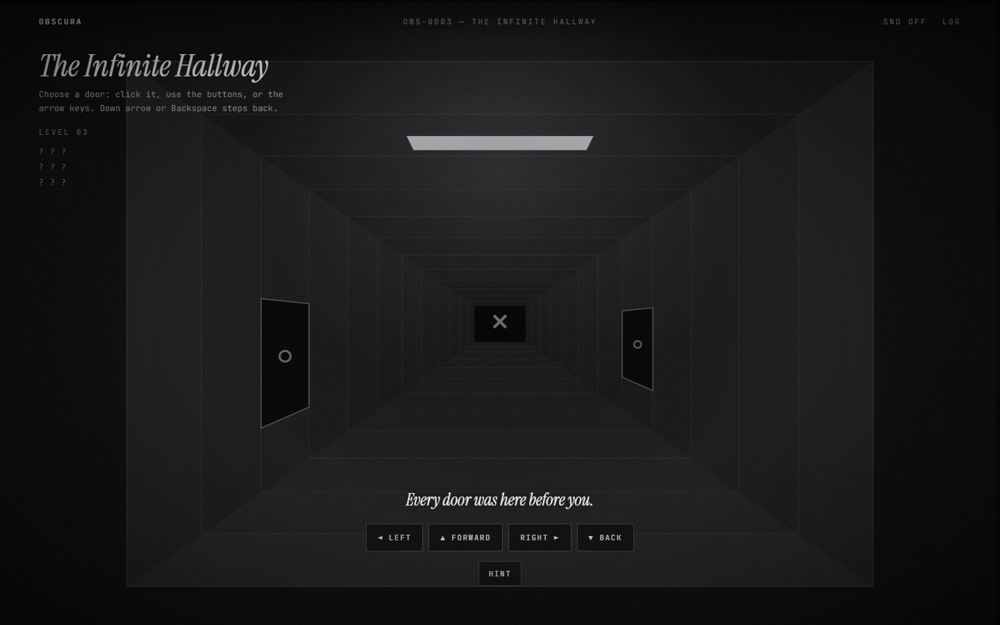
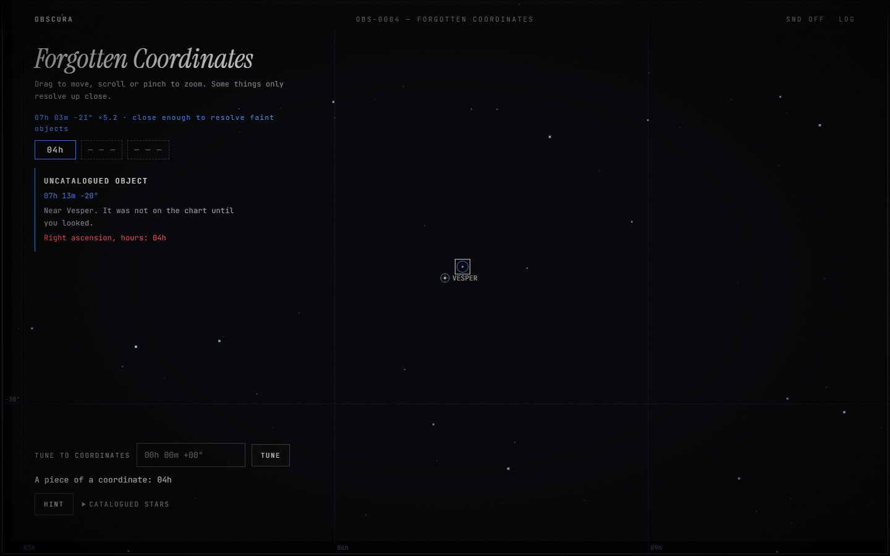
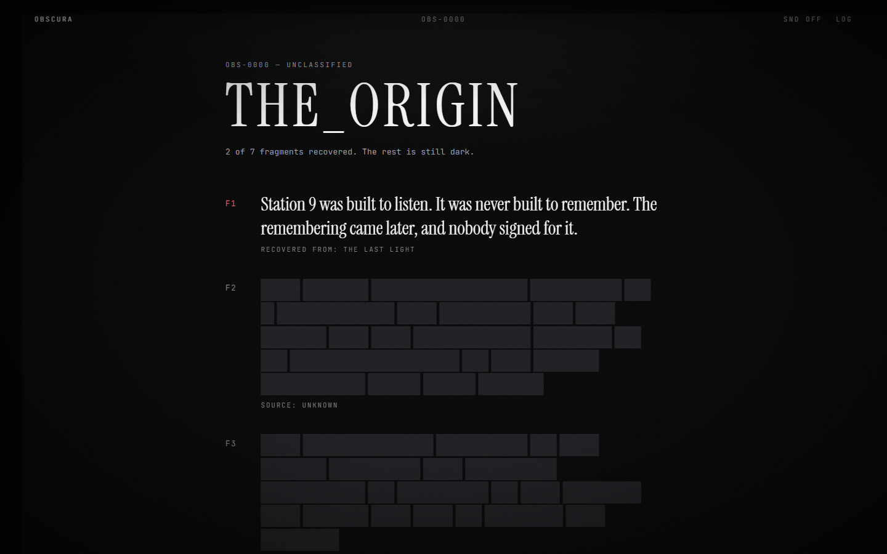
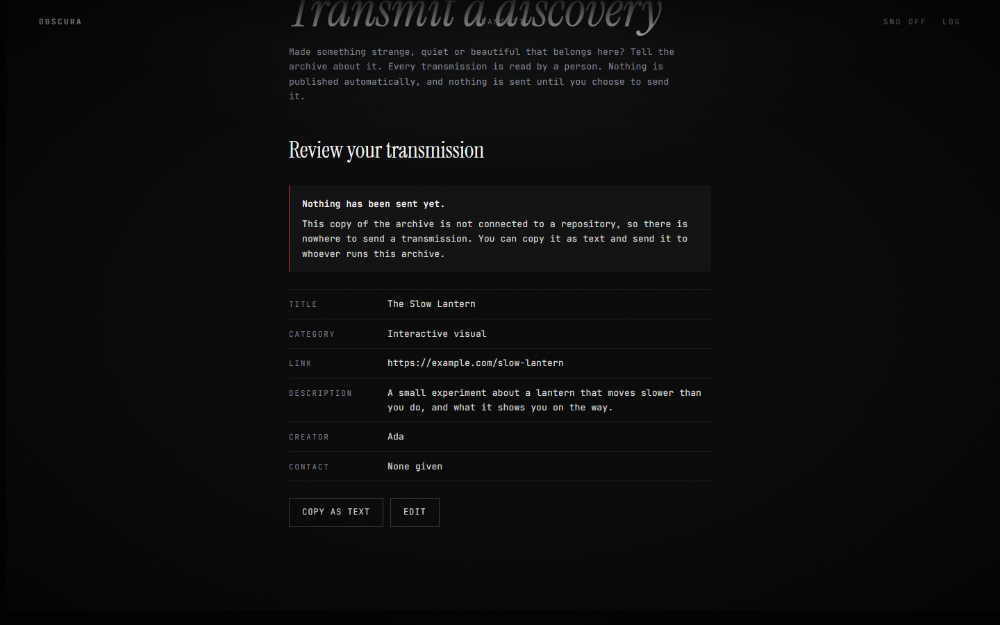
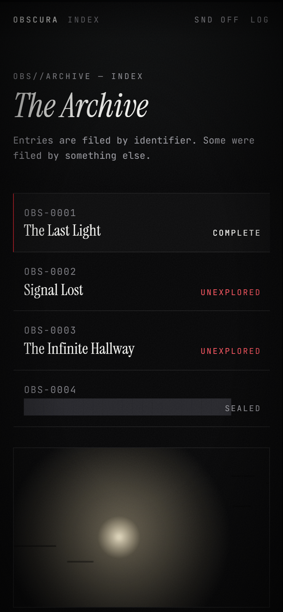

# OBSCURA

**The Digital Discovery Archive.**

> You weren't supposed to find this.
> Somewhere between the known and the forgotten, something remains.

OBSCURA is an experimental website that behaves more like a place than a page. There is no navigation menu on the way in. Visitors find four interactive rooms, a handful of hidden routes, and a fictional history that has to be pieced together from fragments scattered through the archive.

It is a static site: no backend, no accounts, no tracking, no API keys, and no AI service. Everything runs in the browser.

**Live demo:** _add your GitHub Pages address here once it is deployed (see [docs/DEPLOYMENT.md](docs/DEPLOYMENT.md))._



## Contents

- [What is in it](#what-is-in-it)
- [Screenshots](#screenshots)
- [Technology](#technology)
- [Getting started](#getting-started)
- [Architecture](#architecture)
- [Community submissions](#community-submissions)
- [Deployment](#deployment)
- [Testing](#testing)
- [Accessibility](#accessibility)
- [Privacy](#privacy)
- [Roadmap](#roadmap)
- [A note on spoilers](#a-note-on-spoilers)

## What is in it

**The entrance.** A cinematic opening of about five seconds: an archive identifier, a title that resolves out of the dark, a message that types itself with a flickering cursor, and a custom **ENTER THE ARCHIVE** control. It can be skipped at any moment (Escape or the skip button), it is remembered so returning visitors go straight in, and it can be replayed from the archive.

**The archive.** A terminal-inspired index, not a grid of cards. Entries are filed by identifier (`OBS-0001`), each with a classification, a short description, a generated "specimen" plate and a discovery status. Rows lean toward the pointer, some entries are sealed until you have earned them, and a command prompt accepts identifiers and commands.

**Four rooms**, each with its own visual identity and interaction design:

| Room | What it is |
| --- | --- |
| **001 The Last Light** | A dark room and a light you steer. Messages on the walls appear only where the light rests. Pointer, touch and keyboard controls, and a text alternative. |
| **002 Signal Lost** | Three scrambled transmissions to decode: a dial with a live signal-strength meter, a phase switch, and a keyword lock. Escalating hints, never a dead end. |
| **003 The Infinite Hallway** | A perspective corridor drawn in canvas, with three doors at every position. The hallway invents every place the same way every time, and a few places are not like the others. |
| **004 Forgotten Coordinates** | A generated star map with pan, wheel and pinch zoom. Faint objects resolve only up close, and a typed coordinate reveals what was never charted. |

**Hidden discoveries.** Real, working hidden interactions: words that respond to touch, keyboard sequences, identifiers that lead to unlisted entries, rooms that unlock after others, and one place you can only reach by being still. Hints escalate gradually, and nobody is ever trapped. Browser back and forward always work.

**A story to return for.** Seven fragments of the archive's fictional history are scattered across the rooms and the hidden routes. They assemble on a secret page, **THE_ORIGIN**, which shows how much is still redacted whenever you visit.

**Discovery tracking.** Progress, fragments and achievements are stored locally. There is a personal discovery log with a history, in-world notifications, and a full reset. There are no fabricated statistics and no community counts.

**Community transmissions.** Visitors can propose their own work. Submissions are validated, spam-resistant and moderated, and **nothing is published without a person approving it.** See [Community submissions](#community-submissions).

**Atmosphere, with restraint.** Film grain, a vignette, sparing glitch effects, and all sound synthesised with the Web Audio API (no audio files). Sound is off until the visitor turns it on.

## Screenshots

These are real captures of the running site. They avoid showing the secrets.

| | |
| --- | --- |
|  |  |
|  |  |
|  |  |
|  |  |

## Technology

- **Vanilla JavaScript** (ES modules), with no framework.
- **Vite** for development and the production build.
- **Canvas 2D** for the light, the hallway and the star map; **Web Audio** for synthesised sound.
- **Self-hosted fonts** through Fontsource: Instrument Serif and JetBrains Mono.
- **Node's built-in test runner** (`node:test`) for the logic.

The whole project has three dependencies: `vite` (dev) and two font packages. There are no runtime network requests to third parties.

## Getting started

Requires Node.js 20 or newer.

```bash
git clone https://github.com/<your-username>/obscura.git
cd obscura
npm install
npm run dev
```

| Command | What it does |
| --- | --- |
| `npm run dev` | Start the dev server with hot reload |
| `npm test` | Run the test suite |
| `npm run build` | Create a static production build in `dist/` |
| `npm run preview` | Serve the production build locally |

To let the submission form open GitHub issues from a local build, copy `.env.example` to `.env` and set `VITE_GITHUB_REPO=owner/obscura`. Without it the form still works, and says honestly that it is not connected to a repository.

## Architecture

The rule is that **logic knows nothing about the DOM**. Every puzzle, rule and validator is a pure function that can be tested in plain Node. The rooms are thin rendering layers over those functions.

```
src/
  core/        Pure logic, no DOM
    catalog.js     Entries, story fragments, achievements
    progress.js    Progress as a pure reducer: discoveries, hints, history, reset
    access.js      What is hidden, sealed, open or complete
    commands.js    Parses what a visitor types at the prompt
    sequence.js    Detects a word typed anywhere on a screen
    routes.js      Hash routes
    lights.js      Room 001: what a moving light reveals
    cipher.js      Room 002: the ciphers, decoding and signal strength
    hallway.js     Room 003: the position model and its special places
    starmap.js     Room 004: the generated sky and the coordinate parser
    submission.js  Validation, sanitising, spam checks, the GitHub issue link
    prng.js        Seeded randomness, so generated worlds never change
  engine/      Shared browser systems
    store.js       Persisted progress store with corruption handling
    audio.js       Synthesised sound
    motion.js      Reduced-motion aware helpers
    dom.js         Tiny DOM helper and animation loop
  ui/          Screens: entrance, archive, journal, THE_ORIGIN, submit, shell
  rooms/       One module per room, loaded on demand
  styles/      Tokens, base, shell, screens, rooms
tests/         node:test suites for core logic
```

Decisions worth knowing about:

- **Rooms are lazy-loaded.** Each room's code only downloads when someone walks in, so the first screen stays small.
- **Generated worlds are deterministic.** The hallway and the sky come from seeded generators, so a place looks the same every time, and puzzles can rely on it.
- **Untrusted input is normalised.** Anything read from `localStorage` goes through `normalizeProgress`: unknown ids are dropped, bad dates are discarded, and prototype pollution is covered by a test. Damaged data can never crash the archive.
- **Nothing is ever a dead end.** Sealed rooms say what they need, every puzzle has escalating hints, the header always links back to the archive, and each canvas room has a non-visual route.
- **Hash routing** (`#/room/001`) means the site works on static hosting with no server rewrites, and the browser's back button works everywhere.

## Community submissions

GitHub Pages is static, so there is no server to receive submissions. Rather than pretend otherwise, OBSCURA uses an architecture that is honest about this:

1. The visitor fills in a form. It is validated and sanitised in the browser.
2. They review it. The page states plainly that **nothing has been sent yet.**
3. They choose **Open on GitHub**, which opens a *prefilled draft issue* on the archive's repository. They must press "Submit new issue" themselves, with their own GitHub account.
4. The maintainer reviews it by hand. Only approved entries are added to `public/community.json`, which is the only thing the site ever displays.

**Spam and abuse protection, by layer:** a hidden honeypot field; a minimum fill time; a daily client-side rate limit; strict validation (https-only public links, no credentials, no IP addresses, no internal hosts, hidden and bidirectional characters stripped); and, most importantly, a GitHub account requirement plus human review. The client-side layers stop accidents and low-effort bots. They are not a security boundary, and the documentation says so. Everything shown from `community.json` is re-validated at load, and a test validates the committed file.

If the repository is not configured, the form says so and offers to copy the submission as text.

See [docs/MODERATION.md](docs/MODERATION.md) for the review workflow.

## Deployment

The repository includes a GitHub Actions workflow that tests, builds and deploys to GitHub Pages on every push to `main`. It sets `VITE_GITHUB_REPO` to the repository automatically. The build uses relative paths, so it works from a project site such as `https://<you>.github.io/obscura/`. Full steps are in [docs/DEPLOYMENT.md](docs/DEPLOYMENT.md).

## Testing

```bash
npm test
```

The suites cover the unlock graph (it checks that every entry can be reached and that there are no cycles), the progress reducer, import normalisation, command parsing, the keyboard-sequence detector, routing, the light model, all three ciphers (solvable, and not solved by near misses), the hallway's special positions and loops, the star map, the coordinate parser, and every layer of submission validation.

Beyond unit tests, the rooms were played end to end with scripted real input in a headless browser (mouse, keyboard, touch emulation), and every screen was audited for contrast, accessible names, duplicate ids, ARIA references and heading structure.

## Accessibility

- Everything works by keyboard. The archive supports arrow keys and `/` to reach the prompt, and each room documents its own keys.
- The two canvas rooms that need visual precision have non-visual routes: The Last Light can reveal its messages as text, and Forgotten Coordinates can read out its coordinate pieces once every hint has been used. A list of catalogued stars also moves the map without dragging.
- `prefers-reduced-motion` is respected: the entrance appears at once, grain and flicker stop, and transitions become instant.
- Text contrast is verified above 4.5:1 across all screens. Form errors are tied to their fields, and live regions announce discoveries.
- The quiet room only counts large pointer movement, so keyboard and screen-reader users are never penalised.

This was checked with automated DOM audits and keyboard testing. It has not had a formal audit with assistive technology, so it makes no WCAG conformance claim.

## Privacy

OBSCURA stores progress in your browser's `localStorage` (`obscura:progress:v1`) and a list of timestamps used for the submission rate limit (`obscura:submissions:v1`). There is no analytics and no tracking. The only network request the site makes by itself is loading its own `community.json`. If a submission is sent, it goes to GitHub only after you press the button there.

## Roadmap

- A fifth room, and more fragments of the archive's story.
- Optional shared "echoes": traces other visitors leave in rooms, behind real moderation.
- Embedded, per-room soundscapes with a mixer.
- A moderation helper script that turns an approved issue into a `community.json` entry.
- Browser-level end-to-end tests that replay each room.

## A note on spoilers

This README describes the experience without giving away its secrets. If you have built or maintain OBSCURA and want the complete solution guide, it is in [docs/SECRETS.md](docs/SECRETS.md). **It spoils everything.**

## License

[MIT](LICENSE)
